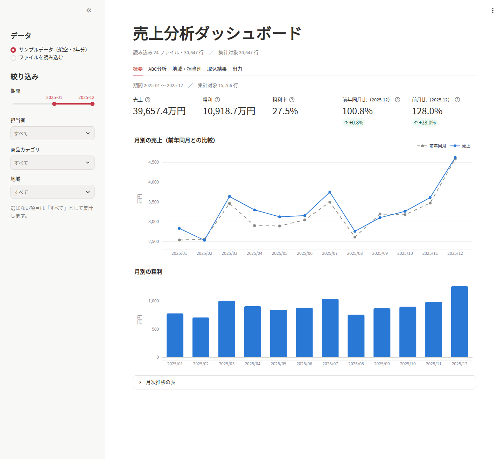
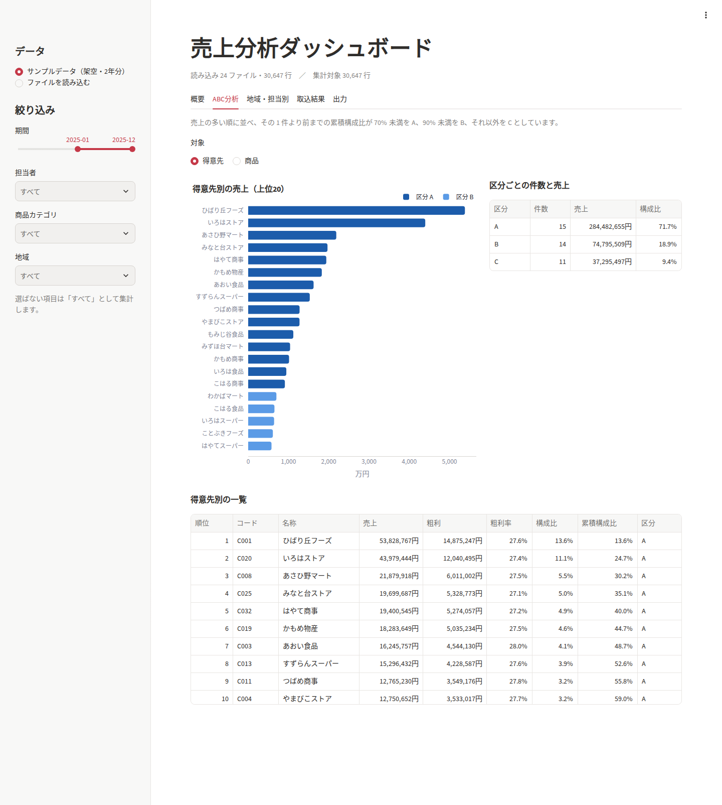
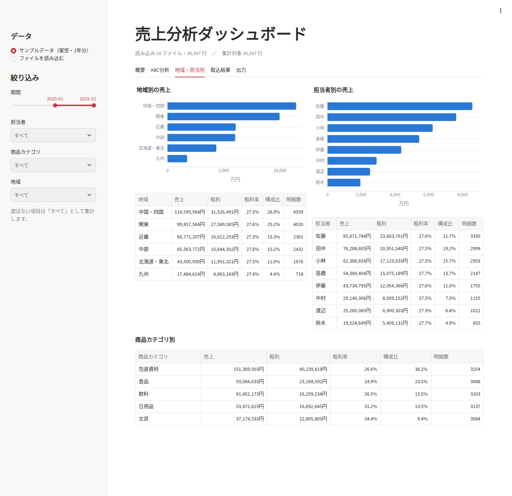
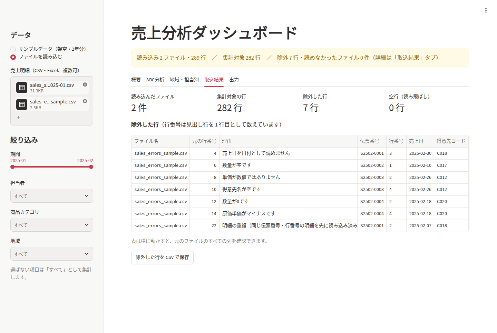
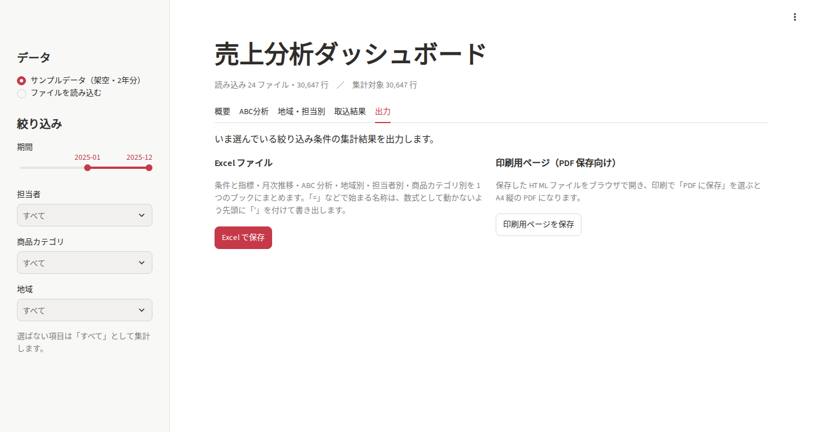
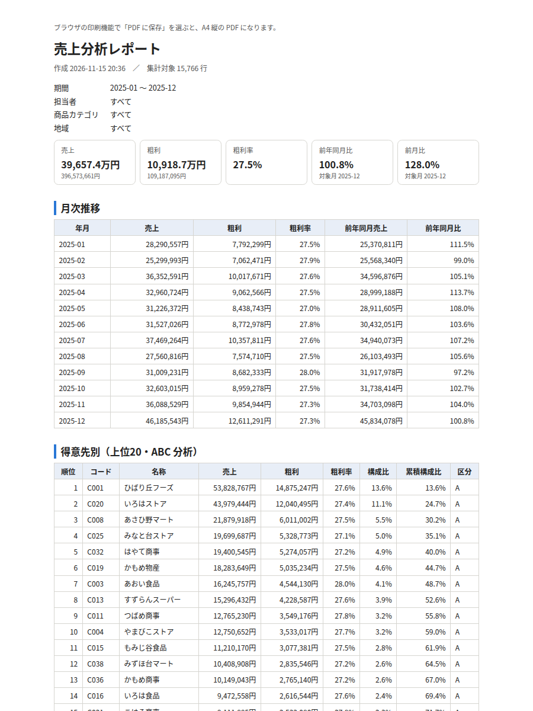
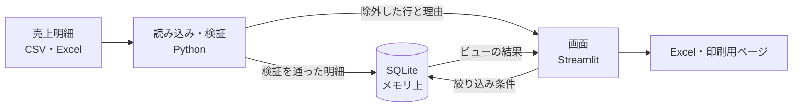

# 売上分析ダッシュボード

[](https://github.com/takato-y/sales-dashboard-streamlit/actions/workflows/test.yml)

- GitHub Actions で検査している範囲：集計・読み込み・出力の自動テストと性能のテスト（pytest）
- 手元の環境でのみ確かめた範囲：画面の操作と目視の確認（TC-080〜TC-084）。SQL Server・Microsoft Excel・事務用 PC 相当・Windows での確認（TC-085〜TC-088）は未実施

毎月の売上明細（CSV・Excel）を読み込むだけで、売上・粗利・前年同月比などの指標、月別の推移、得意先・商品の ABC 分析、地域別・担当者別の内訳がそろう Web 画面です。明細の誤りは集計の前に見つけて理由とともに示し、絞り込んだ結果は Excel と印刷用のページに出力できます。

本リポジトリはポートフォリオ（閲覧用）です。無断での再利用・再配布はご遠慮ください。

| 作業 | これまで | 導入後 |
|---|---|---|
| 複数月の明細の取りまとめ | CSV を 1 か月ずつ Excel に貼り合わせる。同じ月を二重に貼る誤りが起きる | ファイルをまとめて選ぶだけ。同じ明細の二重計上は自動で除外する |
| 明細の誤りの確認 | 集計後に数字が合わず、原因の行を探す | 読み込み時に、ファイル名・行番号・理由（日付の誤り・数量の空欄など）を一覧で示す |
| 前年同月比・前月比 | 対象月をずらすたびに関数の参照範囲を直す | 期間を選ぶだけで計算される |
| 担当別・カテゴリ別の集計 | 依頼のたびにピボットを作り直す | 画面で条件を選ぶと、すべての指標・グラフ・表がその場で切り替わる |
| 会議資料 | 集計結果を毎月体裁を整えて作る | Excel と A4 の印刷用ページをボタン 1 つで保存する |

この画面は**認証なし・ローカル専用**です。利用者自身の PC（127.0.0.1）でだけ開ける設定にしており、読み込んだデータは外部に送らず、ディスクにも保存しません。データはすべて架空のものです。

## 概要

食品・日用品などを扱う架空の小規模卸売会社を想定しています。販売管理システムから出力した売上明細を読み込み、月初の営業会議で使う指標と資料を作ります。

- **ABC 分析**：売上の多い順に並べ、累積の構成比で重要度を A（上位で売上の約 7 割）・B・C に分ける方法です。
- **粗利**：売上金額から原価金額を引いた額です。

## できること

- 複数月の CSV（UTF-8・Shift_JIS）・Excel をまとめて読み込む。サンプルデータ（架空・2 年分）でも試せる
- 読み込み時の検証：必須項目の空欄、日付・数量・単価の誤り、明細の重複を見つけ、該当行を集計から除外して理由を示す（全角数字・桁区切りのカンマ・「円」は自動で整える）
- 指標：売上・粗利・粗利率・前年同月比・前月比
- 月別の売上（前年同月との比較）・粗利のグラフ
- 得意先別・商品別の上位と ABC 分析
- 地域別・担当者別・商品カテゴリ別の内訳
- 期間・担当者・商品カテゴリ・地域での絞り込み
- 絞り込んだ結果の Excel 出力と、A4 で印刷・PDF 保存できる印刷用ページ
- 季節変動のある 2 年分の架空データの生成

## 画面

| 概要 | ABC 分析 |
|---|---|
|  |  |

| 地域・担当別 | 取込結果（誤りを含むファイル） |
|---|---|
|  |  |

| 出力 | 印刷用ページ |
|---|---|
|  |  |

画像は実際に画面を起動し、ヘッドレスのブラウザ（Chromium）で撮影したものです。

## 指標の定義

| 指標 | 計算式 |
|---|---|
| 売上 | 数量 × 単価 の合計 |
| 粗利 | 売上 − 原価（数量 × 原価単価）の合計 |
| 粗利率 | 粗利 ÷ 売上 |
| 前年同月比 | 対象月の売上 ÷ 前年同月の売上（対象月は選んだ期間の最終月） |
| 前月比 | 対象月の売上 ÷ 前月の売上 |
| ABC 区分 | 売上の多い順に並べ、その 1 件より前までの累積構成比が 70% 未満は A、90% 未満は B、それ以外は C |

分母が 0 以下のとき、または前年同月・前月のデータを読み込んでいないときは「—」と表示します。計算はすべて SQL のビューで行っています（定義の詳細は [基本設計書の「指標の定義」](docs/02_基本設計.md#4-指標の定義)）。

## 構成

| 技術 | 担当 |
|---|---|
| **Python**（pandas） | ファイルの読み込み、文字コードの判定、値の整形と検証、Excel・印刷用ページの出力、架空データの生成 |
| **SQL**（SQLite） | 表の定義、明細の取込と金額の計算、指標・月次推移・ABC 分析・内訳のビュー。SQL Server 向けの T-SQL 版も用意（未実行） |
| **Streamlit**（Plotly） | 画面とグラフ。画面はビューの結果を読んで表示するだけで、計算式を持たない |



```text
app/streamlit_app.py        画面
sales_dashboard/            業務ロジック（loader 読み込み・検証 / db SQL の適用と呼び出し / export 出力 / generator 架空データ）
sql/                        001_schema.sql・002_views.sql（版つき）、procedures/、sqlserver/（T-SQL 版）
tests/                      自動テスト（75 件）
scripts/                    架空データの生成、画面の撮影
docs/                       設計書
```

### 要件・機能・テストのつながり（抜粋）

| 要件 | 機能 | テスト |
|---|---|---|
| REQ-002 誤りのある行を理由つきで除外 | FN-002 検証・整形 | TC-010〜TC-018 |
| REQ-003 指標 | FN-004 指標（`v_kpi`） | TC-020・TC-024・TC-026・TC-027 |
| REQ-005 ABC 分析 | FN-006 ABC 分析（`v_abc_*`） | TC-030・TC-031 |
| REQ-011 出力時の無害化 | FN-008 Excel 出力・FN-009 印刷用ページ | TC-060〜TC-064 |
| REQ-101 10 万行を 10 秒以内 | FN-012 SQL への取込 | TC-070（1.71 秒） |

### 設計書

| 文書 | 内容 |
|---|---|
| [01_要件定義.md](docs/01_要件定義.md) | 背景・課題・要件（REQ）・対象外 |
| [02_基本設計.md](docs/02_基本設計.md) | 構成図・機能一覧（FN）・画面一覧・指標の定義 |
| [03_詳細設計.md](docs/03_詳細設計.md) | 読み込み・検証・集計の流れ、例外表（ERR） |
| [04_入力データ仕様.md](docs/04_入力データ仕様.md) | 列定義・検証ルール |
| [05_テスト仕様書.md](docs/05_テスト仕様書.md) | テストケース（TC）と実施結果 |
| [06_導入・運用手順.md](docs/06_導入・運用手順.md) | 導入・起動・毎月の使い方・定期点検・バックアップ・連絡体制 |
| [07_方式設計.md](docs/07_方式設計.md) | 技術の役割分担、集計に SQL を使う理由、版の管理 |
| [08_テーブル定義書.md](docs/08_テーブル定義書.md) | テーブル・ビューの定義と ER 図 |
| [09_障害対応手順書.md](docs/09_障害対応手順書.md) | 障害時の切り分け・エラーID（ERR）ごとの対処・記録と報告 |
| [docs/adr/](docs/adr/) | 判断の記録（画面方式・ABC の区分・無害化・SQL による集計） |
| [sql/README.md](sql/README.md) | SQL ファイルの一覧と、SQL Server へ移すときの違い |
| [CHANGELOG.md](CHANGELOG.md) | 変更履歴 |

## 使い方

```bash
python3 -m venv .venv
source .venv/bin/activate
pip install -r requirements.txt
streamlit run app/streamlit_app.py --server.address 127.0.0.1
```

ブラウザで表示されたアドレス（`http://127.0.0.1:8501` など）を開きます。最初はサンプルデータ（架空・2 年分）が表示されます。自社のデータを使うときは、サイドバーで「ファイルを読み込む」を選び、売上明細を選びます。

売上明細には次の 13 列が必要です（順序は問いません。詳細は [入力データ仕様](docs/04_入力データ仕様.md)）。

`伝票番号, 行番号, 売上日, 得意先コード, 得意先名, 地域, 担当者, 商品コード, 商品名, 商品カテゴリ, 数量, 単価, 原価単価`

形式の例は `samples/sales_sample_2025-01.csv`、誤りを含む例は `samples/sales_errors_sample.csv` です。

テストは `pip install -r requirements-dev.txt` の後に `python -m pytest -v` で実行します。

## 工夫した点

- **計算式を SQL のビューに集めた**：画面・Excel・印刷用ページが同じビューを読むため、出力物ごとに数字がずれません。社内のデータベースや BI ツールに移すときも、ビューの定義をそのまま使えます。SQL ファイルには番号を付け、適用した版をデータベースに記録します。
- **数字の正しさを別の方法で確かめた**：指標・ABC 分析・内訳の自動テストでは、pandas も SQL も使わない素朴な計算で期待値を求め、ビューの結果と突き合わせています。
- **誤りがあっても止めない**：読めないファイルや誤りのある行があっても、残りは集計し、除外した行と理由を一覧と CSV で返します。同じ明細の二重計上は、ファイルをまたいでも除外します。
- **「0」と「データなし」を区別した**：前年のデータを読み込んでいない月は「—」、データはあるが該当がない月は 0 とし、前年同月比が誤って 0% や無限大になることを防いでいます。
- **出力時の無害化**：得意先名などが「=」「+」「-」「@」などで始まる場合、Excel では先頭に「'」を付けて文字列として書き、数式として動かないようにしています。印刷用ページでは文字列をすべてエスケープしています。
- **ローカル専用の設定**：127.0.0.1 でだけ待ち受け、データベースはメモリ上に作り、画面にはエラーの詳細（ファイルの場所など）を出しません。

## 確認していないこと

- SQL Server 版（`sql/sqlserver/`）の実行（実行環境がないため、構文・結果とも未確認）
- 出力した Excel を Microsoft Excel（デスクトップ版）で開いたときの表示（openpyxl での読み戻しと、数式が含まれないことは自動テストで確認済み）
- 事務用の PC 相当の環境での性能（開発用の PC では CSV 10 万行の読み込み〜集計が 1.71 秒。Excel 10 万行は読み込みだけで 7.91 秒）
- Windows（WSL を使わない環境）・macOS での起動、Chromium 以外のブラウザでの表示
- 印刷用ページの印刷は Chromium の PDF 出力で確認（A4 縦 3 ページ）。実際のプリンタへの印刷は未確認

## 動作環境

| 項目 | 確認した環境 |
|---|---|
| OS | Linux（Windows 上の WSL2） |
| Python | 3.12.3 |
| 主なライブラリ | pandas 3.1.1、Streamlit 1.67.0、Plotly 7.1.0、openpyxl 3.1.5（`requirements.txt`） |
| データベース | SQLite 3.45.1（Python 標準の sqlite3） |
| ブラウザ | Chromium（Playwright 1.65.2 に含まれるもの） |
