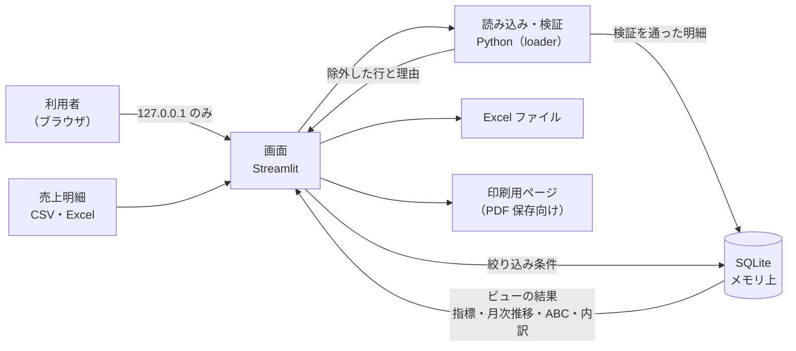

# 基本設計書

## 文書情報

| 項目 | 内容 |
|---|---|
| 文書名 | 基本設計書 |
| 文書ID | BD-001 |
| システム名 | 売上分析ダッシュボード |
| 版 | 1.0 |
| 作成日 | 2026-11-15 |
| 状態 | 承認済 |

## 改版履歴

| 版 | 日付 | 変更内容 |
|---|---|---|
| 1.0 | 2026-11-15 | 新規作成 |

## 1. システム構成

利用者の PC の中だけで動きます。画面（Streamlit）・読み込みと検証（Python）・集計（SQL）の 3 つの層に分け、集計の式はすべて SQL のビューに置きます。層の分け方と SQL を使う理由は [07_方式設計.md](07_方式設計.md) に記載します。



| 層 | 置き場所 | 役割 |
|---|---|---|
| 画面 | `app/streamlit_app.py` | ファイル選択・絞り込み・表示・ダウンロード。集計の式は持たない |
| 読み込み・検証 | `sales_dashboard/loader.py` | 文字コード判定、列の確認、値の整形、行ごとの検証、重複の判定 |
| 集計 | `sql/*.sql`、`sales_dashboard/db.py` | 表への取込、指標・月次推移・ABC 分析・内訳のビュー。Python は条件を書いてビューを読むだけ |
| 出力 | `sales_dashboard/export.py` | Excel・印刷用ページの作成と、文字列の無害化 |
| 架空データ | `sales_dashboard/generator.py`、`scripts/generate_data.py` | 2 年分の架空の売上明細 |

## 2. 機能一覧

| ID | 機能名 | 概要 | 関連要件 | 主な実装 |
|---|---|---|---|---|
| FN-001 | ファイル読み込み | CSV（UTF-8・Shift_JIS）と Excel を読み、複数ファイルをファイル名順に結合する | REQ-001 | `loader.read_table`・`load_files` |
| FN-002 | 検証・整形 | 全角・カンマ・円記号の整形、必須・日付・数値の検証、明細の重複の除外。除外した行に理由を付ける | REQ-002 | `loader._validate` |
| FN-003 | 絞り込み | 期間・担当者・商品カテゴリ・地域の条件を条件表に書き、ビューで絞り込む | REQ-007 | `filters.FilterCondition`、`v_dim_line`・`v_filtered_line` |
| FN-004 | 指標 | 売上・粗利・粗利率・前年同月比・前月比 | REQ-003 | `v_kpi` |
| FN-005 | 月次推移 | 月ごとの売上・粗利・粗利率と前年同月の売上 | REQ-004 | `v_monthly_sales` |
| FN-006 | ABC 分析 | 得意先別・商品別の売上順位と A・B・C の区分 | REQ-005 | `v_abc_customer`・`v_abc_product` |
| FN-007 | 地域別・担当者別 | 地域・担当者・商品カテゴリごとの売上・粗利・構成比 | REQ-006 | `v_breakdown` |
| FN-008 | Excel 出力 | 絞り込み後の集計を 1 つのブックに出力。数式に見える文字列を無害化 | REQ-008、REQ-011 | `export.build_excel` |
| FN-009 | 印刷用ページ | A4 縦で印刷できる HTML を出力。文字列をエスケープ | REQ-009、REQ-011 | `export.build_print_html` |
| FN-010 | 架空データ生成 | 2 年分・季節変動つきの架空の明細を生成 | REQ-010 | `generator.generate_sales` |
| FN-011 | 画面 | 6 画面（SCR-001〜SCR-006）。127.0.0.1 でのみ待ち受ける | REQ-102、REQ-103 | `app/streamlit_app.py` |
| FN-012 | SQL への取込と版の管理 | 番号付き SQL の適用（版の記録）と、明細の取込・金額の計算 | REQ-001、REQ-101、REQ-102 | `db.SalesDB`、`sql/procedures/load_sales.sql` |

## 3. 画面一覧

| ID | 画面名 | 目的 | 主な機能 |
|---|---|---|---|
| SCR-001 | 概要 | 期間の指標と月次推移をひと目で見る | FN-004、FN-005 |
| SCR-002 | ABC 分析 | 売上の大きい得意先・商品と区分を見る | FN-006 |
| SCR-003 | 地域・担当別 | 地域・担当者・カテゴリの内訳を見る | FN-007 |
| SCR-004 | 取込結果 | 読み込んだファイル数・除外した行と理由を確かめる | FN-001、FN-002 |
| SCR-005 | 出力 | Excel・印刷用ページを保存する | FN-008、FN-009 |
| SCR-006 | 印刷用ページ | 保存した HTML をブラウザで開き、印刷・PDF 保存する | FN-009 |

SCR-001〜SCR-005 は同じページのタブで、左側のサイドバー（データの選択・絞り込み）を共通で使います。

### 3.1 画面レイアウト（SCR-001〜SCR-005 共通）

```text
┌────────────┬──────────────────────────────────────────────┐
│ データ      │ 売上分析ダッシュボード                          │
│ ○サンプル   │ 読み込み n ファイル・n 行 ／ 集計対象 n 行        │
│ ○ファイル   │ （除外があれば黄色の帯で件数を表示）              │
│ [ファイル選択]│ [概要][ABC分析][地域・担当別][取込結果][出力]   │
│            ├──────────────────────────────────────────────┤
│ 絞り込み    │ タブごとの内容                                  │
│ 期間 ●───● │  概要：指標 5 つ → 月別の売上（前年比較）→ 月別の粗利 │
│ 担当者 [▼]  │  ABC：対象の切替 → 上位 20 のグラフと区分の集計 → 一覧 │
│ カテゴリ[▼] │  地域・担当別：グラフと表を 2 列 → カテゴリ別の表     │
│ 地域   [▼]  │  取込結果：件数 4 つ → 除外した行の表 → CSV 保存     │
│            │  出力：Excel で保存 ／ 印刷用ページを保存           │
└────────────┴──────────────────────────────────────────────┘
```

実際の画面は README の「画面」と `docs/images/` を参照してください。

## 4. 指標の定義

計算はすべて SQL のビュー（`sql/002_views.sql`）で行います。割合は分母が 0 以下のとき算出せず、画面には「—」と表示します。

| 指標 | 計算式 | 対象の明細 | ビュー・列 |
|---|---|---|---|
| 売上金額（明細） | 数量 × 単価 | — | `t_sales_line.sales_amount`（取込時に計算） |
| 原価金額（明細） | 数量 × 原価単価 | — | `t_sales_line.cost_amount` |
| 粗利（明細） | 売上金額 − 原価金額 | — | `t_sales_line.gross_profit` |
| 売上 | Σ 売上金額 | すべての条件で絞り込んだ明細 | `v_kpi.sales` |
| 粗利 | Σ 粗利 | 同上 | `v_kpi.gross_profit` |
| 粗利率 | 粗利 ÷ 売上 | 同上 | `v_kpi.gross_margin`、`v_monthly_sales.gross_margin` |
| 前年同月比 | 対象月の売上 ÷ 前年同月の売上 | 担当者・カテゴリ・地域で絞り込んだ明細（期間は問わない） | `v_kpi.yoy`、`v_monthly_sales.yoy` |
| 前月比 | 対象月の売上 ÷ 前月の売上 | 同上 | `v_kpi.mom`、`v_monthly_sales.mom` |
| 構成比 | その項目の売上 ÷ 項目全体の売上 | すべての条件で絞り込んだ明細 | `v_abc_*.share`、`v_breakdown.share` |
| 累積構成比 | 売上の多い順に構成比を足し上げた値 | 同上 | `v_abc_*.cum_share` |
| ABC 区分 | その 1 件より前までの累積構成比が 70% 未満は A、90% 未満は B、それ以外は C。売上 0 以下は C | 同上 | `v_abc_*.abc_class` |

補足：

- 対象月は、絞り込んだ期間の最終月です。
- 「読み込んだデータにその月が 1 行もない」場合は値なし（「—」）、「データはあるが条件に合う明細がない」場合は 0 とします。前年同月の売上が 0 の月は前年同月比を算出しません。
- 返品（数量がマイナス）があると、項目の売上がマイナスになることがあります。その場合、構成比の合計が 100% を超えることがあります。
- 同じ売上金額の項目はコードの昇順に並べます（ADR-0002）。
