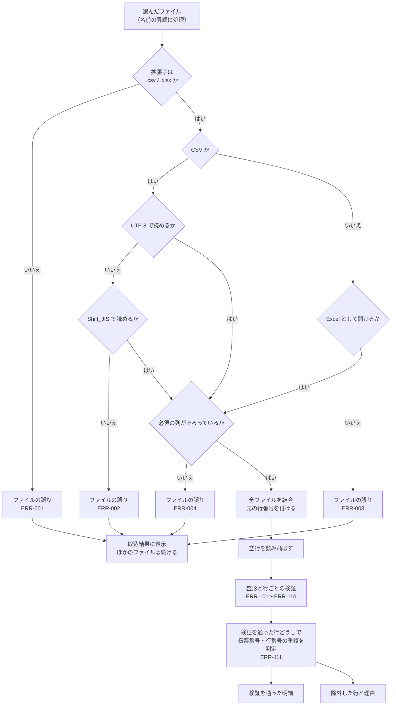
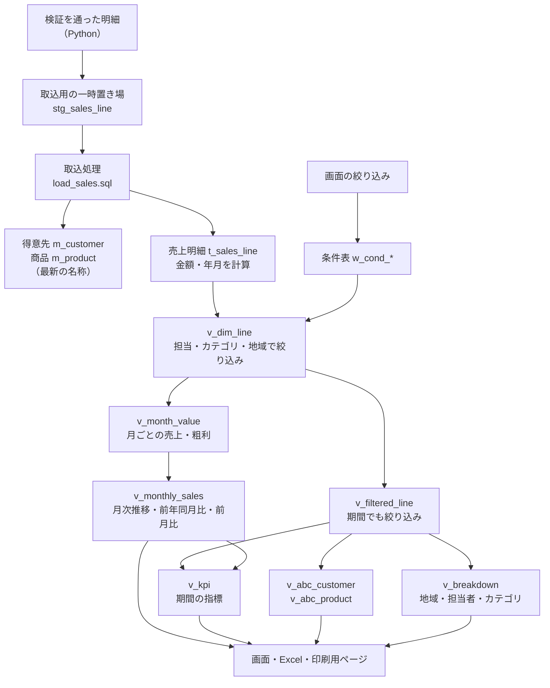

# 詳細設計書

## 文書情報

| 項目 | 内容 |
|---|---|
| 文書名 | 詳細設計書 |
| 文書ID | DD-001 |
| システム名 | 売上分析ダッシュボード |
| 版 | 1.0 |
| 作成日 | 2026-11-15 |
| 状態 | 承認済 |

## 改版履歴

| 版 | 日付 | 変更内容 |
|---|---|---|
| 1.0 | 2026-11-15 | 新規作成 |

## 1. 読み込み・検証の流れ（FN-001・FN-002）

## 2. 集計の流れ（FN-003〜FN-007・FN-012）

- データベースは画面のセッションごとにメモリ上に 1 つ作り、ディスクには書きません（REQ-102）。読み込むファイルが変わったときだけ作り直します。
- `sql/` の番号付きファイルは番号順に一度だけ適用し、`schema_version` 表に記録します。適用済みのファイルは書き換えず、変更は新しい番号のファイルで行います。
- 絞り込み条件は条件表（`w_cond_period`・`w_cond_staff`・`w_cond_category`・`w_cond_region`）に書きます。担当者などの表に行がなければ「すべて」とみなします。表名・列名は `db.py` の固定の対応表からだけ組み立て、値はすべてプレースホルダ（`?`）で渡します。

## 3. 整形と検証の規則

| 対象 | 整形 | 検証 |
|---|---|---|
| コード類（伝票番号・得意先コード・商品コード） | Unicode NFKC 正規化（全角英数を半角に）・前後の空白除去 | 空でない |
| 名称類（得意先名・地域・担当者・商品名・カテゴリ） | 前後の空白除去（全角・半角は変えない） | 空でない |
| 行番号 | NFKC 正規化 | 1 以上の整数 |
| 売上日 | NFKC 正規化 | `YYYY-MM-DD`・`YYYY/MM/DD`・`YYYYMMDD`・Excel の日付、Excel の日付シリアル値（5 桁、30000〜99999） |
| 数量 | NFKC 正規化・カンマ除去 | 整数で 0 以外 |
| 単価・原価単価 | NFKC 正規化・カンマ・円・¥ の除去 | 0 以上の数値 |

1 行に複数の誤りがある場合は、すべての理由を「／」でつないで示します。読み込み時には値の無害化をしません（画面には元の文字列を表示し、出力時にだけ無害化します。ADR-0003）。

## 4. 例外表

| ID | 単位 | 発生条件 | 利用者に示す理由 | 処理 |
|---|---|---|---|---|
| ERR-001 | ファイル | 拡張子が .csv・.xlsx 以外 | 対応していない形式です（.csv または .xlsx を選んでください） | そのファイルを読まずに続ける |
| ERR-002 | ファイル | UTF-8・Shift_JIS のどちらでも読めない | 文字コードを判定できません（UTF-8 または Shift_JIS で保存してください） | 同上 |
| ERR-003 | ファイル | Excel として開けない | Excel ファイルとして開けません | 同上 |
| ERR-004 | ファイル | 必須の列がない | 必須の列がありません：（列名） | 同上 |
| ERR-005 | ファイル | 中身が空・列の数がそろわない CSV | ファイルが空です／CSV として読めません | 同上 |
| ERR-101 | 行 | 必須の文字列項目が空 | （列名）が空です | 行を除外して続ける |
| ERR-102 | 行 | 行番号が空・1 以上の整数でない | 行番号が空です／行番号が1以上の整数ではありません | 同上 |
| ERR-103 | 行 | 売上日が空 | 売上日が空です | 同上 |
| ERR-104 | 行 | 売上日を解釈できない（存在しない日付を含む） | 売上日を日付として読めません | 同上 |
| ERR-105 | 行 | 数量が空 | 数量が空です | 同上 |
| ERR-106 | 行 | 数量が整数でない | 数量が整数ではありません | 同上 |
| ERR-107 | 行 | 数量が 0 | 数量が0です | 同上 |
| ERR-108 | 行 | 単価・原価単価が空 | （列名）が空です | 同上 |
| ERR-109 | 行 | 単価・原価単価が数値でない | （列名）が数値ではありません | 同上 |
| ERR-110 | 行 | 単価・原価単価がマイナス | （列名）がマイナスです | 同上 |
| ERR-111 | 行 | 伝票番号と行番号の組が、先に読んだ明細と同じ | 明細の重複（同じ伝票番号・行番号の明細を先に読み込み済み） | 2 件目以降を除外して続ける |
| ERR-201 | 集計 | SQL の実行に失敗（想定外） | 画面には一般的な失敗の表示だけを出す（詳細は起動した端末に出る） | トランザクションを取り消す |

ERR-201 の画面表示は `.streamlit/config.toml` の `showErrorDetails = "none"` で、ファイルの場所などの詳細を画面に出さないようにしています。

## 5. 出力（FN-008・FN-009）

| 出力 | 内容 | 無害化 |
|---|---|---|
| Excel | シート「条件と指標」「月次推移」「得意先ABC」「商品ABC」「地域別」「担当者別」「商品カテゴリ別」。金額は `#,##0`、割合は `0.0%` の表示形式。A4 横・幅に合わせて印刷 | `=` `+` `-` `@` タブ・CR・LF で始まる文字列の先頭に `'` を付け、セルの型を文字列に固定。数値はそのまま |
| 印刷用ページ | 条件・指標・月次推移・ABC（上位 20）・地域別・担当者別・カテゴリ別。`@page` で A4 縦 | すべての文字列を HTML の特殊文字として変換。外部のスクリプト・画像・フォントを読み込まない |

印刷用ページは画面内に埋め込まず、保存したファイルを別に開きます（利用者のファイル由来の文字列を、画面と同じ出所で動く埋め込みに入れないため）。
