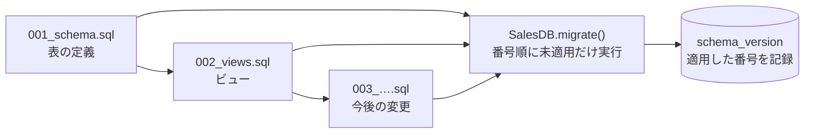

# 方式設計書

## 文書情報

| 項目 | 内容 |
|---|---|
| 文書名 | 方式設計書 |
| 文書ID | AD-001 |
| システム名 | 売上分析ダッシュボード |
| 版 | 1.0 |
| 作成日 | 2026-11-15 |
| 状態 | 承認済 |

## 改版履歴

| 版 | 日付 | 変更内容 |
|---|---|---|
| 1.0 | 2026-11-15 | 新規作成 |

## 1. 使う技術と役割

| 技術 | 版 | 役割 |
|---|---|---|
| Python | 3.12 | 読み込み・検証・整形、SQL の適用と呼び出し、出力（Excel・印刷用ページ）、架空データの生成 |
| SQL（SQLite） | Python 標準の sqlite3（SQLite 3.45 で確認） | 表・取込処理・集計のビュー。指標の計算式はすべてここに置く |
| SQL（SQL Server） | — | 主要な表と関数の T-SQL 版（`sql/sqlserver/`）。未実行 |
| Streamlit | 1.67 | 画面（127.0.0.1 でのみ待ち受け） |
| pandas | 3.1 | ファイルの読み込みと検証、ビューの結果の受け取り |
| Plotly | 7.1 | グラフ |
| openpyxl | 3.1 | Excel の読み込み・出力 |

## 2. 集計に SQL を使う理由

| 観点 | 内容 |
|---|---|
| 計算式を 1 か所に置ける | 指標の定義（売上・粗利率・前年同月比・ABC 区分）をビューの定義として残せる。画面・Excel・印刷用ページは同じビューを読むため、出力物ごとに計算がずれない |
| 既存の業務システムへ移しやすい | 販売管理システムや社内のデータベース（SQL Server など）に移すとき、ビューをほぼそのまま持っていける。Python の画面を使わない場合でも、BI ツールや Excel から同じビューを参照できる |
| 確かめやすい | ビューの結果を、別の方法（標準ライブラリだけの素朴な計算）で求めた期待値と突き合わせる自動テストを置いている（TC-020〜TC-034） |
| 性能 | 10 万行の取込と 8 本のビューの集計で約 1.3 秒（05_テスト仕様書の TC-070） |

役割の分担は次のとおりです。

- **Python に残すもの**：文字コードの判定、全角・半角の整形、日付の書式の判定など、ファイルごとに事情が異なり、行ごとに理由を付けて返す処理。SQL で書くと理由の組み立てが複雑になるため
- **SQL に置くもの**：検証を通った明細の金額計算と、すべての集計

## 3. SQLite を選んだ理由と SQL Server との違い

| 観点 | 判断 |
|---|---|
| 導入の手間 | SQLite は Python に含まれるため、追加の導入が不要。利用者の PC に別のデータベースを入れずに済む |
| データの扱い | メモリ上のデータベースにすれば、読み込んだ明細がディスクに残らない（REQ-102） |
| 同時利用 | 1 つの画面につき 1 つのデータベースを作るため、条件表を使っても他の利用者と衝突しない |
| SQL Server への移行 | 計算式は標準的な SQL（ウィンドウ関数・CTE）で書いている。条件の受け渡しと型は変える必要があり、T-SQL 版を `sql/sqlserver/` に置いた（未実行）。違いの一覧は `sql/README.md` |

DuckDB も候補にしましたが、追加の導入が必要なこと、この規模（10 万行）では SQLite で十分な速さが出ることから採用しませんでした（ADR-0004）。

## 4. 版の管理

- 適用済みのファイルは書き換えません。変更は新しい番号のファイルで行います（例：ビューを作り直すときは `DROP VIEW` と `CREATE VIEW` を新しいファイルに書く）。
- 取込処理 `procedures/load_sales.sql` は表の定義ではないため番号を付けず、読み込みのたびに実行します。

## 5. 非機能の方針

| 要件 | 方針 |
|---|---|
| REQ-101 性能 | 検証は pandas の列単位の処理で行い、行ごとの繰り返しをしない。集計は SQLite のビューで行い、`ym_idx` などに索引を付ける |
| REQ-102 データの扱い | 画面は `127.0.0.1` だけで待ち受ける（起動コマンドと `.streamlit/config.toml` の両方で指定）。データベースはメモリ上に作る。利用状況の送信を止める（`gatherUsageStats = false`）。画面に例外の詳細を出さない |
| REQ-103 操作性 | 誤りのある行があっても止めず、画面上部に件数を出す。絞り込みの未選択は「すべて」 |
| REQ-011 無害化 | 出力時にだけ行う（ADR-0003） |
