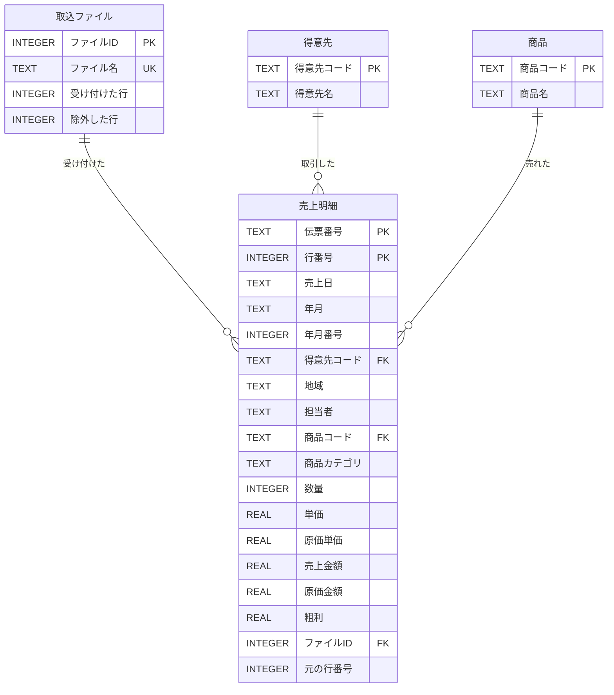

# テーブル定義書

## 文書情報

| 項目 | 内容 |
|---|---|
| 文書名 | テーブル定義書 |
| 文書ID | TD-001 |
| システム名 | 売上分析ダッシュボード |
| 版 | 1.0 |
| 作成日 | 2026-11-15 |
| 状態 | 承認済 |

## 改版履歴

| 版 | 日付 | 変更内容 |
|---|---|---|
| 1.0 | 2026-11-15 | 新規作成 |

## 1. テーブル一覧

正本は `sql/001_schema.sql`（SQLite）です。SQL Server 版は `sql/sqlserver/001_schema.sql`（未実行）です。

| ID | 物理名 | 論理名 | 種別 | 内容 |
|---|---|---|---|---|
| TBL-001 | t_import_file | 取込ファイル | 記録 | 1 回の読み込みで受け付けたファイルと、受け付けた行・除外した行の数 |
| TBL-002 | m_customer | 得意先 | マスタ | 得意先コードと名称（最も新しい売上日の明細の名称） |
| TBL-003 | m_product | 商品 | マスタ | 商品コードと名称（同上） |
| TBL-004 | stg_sales_line | 取込用一時置き場 | 作業 | Python が検証を通った明細を入れる。取込処理の最後に空にする |
| TBL-005 | t_sales_line | 売上明細 | 明細 | 集計の対象。金額・年月は取込時に SQL で計算する |
| TBL-006 | w_cond_period | 条件（期間） | 作業 | 絞り込みの期間（1 行） |
| TBL-007 | w_cond_staff / w_cond_category / w_cond_region | 条件（担当者・カテゴリ・地域） | 作業 | 選んだ値。行がなければ「すべて」 |
| TBL-008 | schema_version | 適用済みの版 | 管理 | 適用した SQL ファイルの番号と日時 |

## 2. ER 図

作業用の表（取込用一時置き場・条件）と管理用の表（適用済みの版）は、ほかの表との参照関係がないため図から省いています。

## 3. テーブル定義

### 3.1 TBL-005 売上明細（t_sales_line）

| No | 物理名 | 論理名 | 型 | 必須 | キー | 内容・計算 |
|---|---|---|---|---|---|---|
| 1 | slip_no | 伝票番号 | TEXT | ○ | PK | 入力の伝票番号（整形後） |
| 2 | line_no | 行番号 | INTEGER | ○ | PK | 入力の行番号 |
| 3 | sales_date | 売上日 | TEXT | ○ | | `YYYY-MM-DD` |
| 4 | ym | 年月 | TEXT | ○ | | `YYYY-MM`（売上日から計算） |
| 5 | ym_idx | 年月番号 | INTEGER | ○ | 索引 | 年 × 12 ＋ 月 − 1。前年同月（−12）・前月（−1）を整数の引き算で求めるため |
| 6 | customer_code | 得意先コード | TEXT | ○ | FK・索引 | m_customer |
| 7 | region | 地域 | TEXT | ○ | | 入力の値（明細ごと） |
| 8 | staff | 担当者 | TEXT | ○ | | 入力の値（明細ごと） |
| 9 | product_code | 商品コード | TEXT | ○ | FK・索引 | m_product |
| 10 | category | 商品カテゴリ | TEXT | ○ | | 入力の値（明細ごと） |
| 11 | quantity | 数量 | INTEGER | ○ | | 0 以外（CHECK 制約）。マイナスは返品 |
| 12 | unit_price | 単価 | REAL | ○ | | 0 以上（CHECK 制約） |
| 13 | unit_cost | 原価単価 | REAL | ○ | | 0 以上（CHECK 制約） |
| 14 | sales_amount | 売上金額 | REAL | ○ | | 数量 × 単価 |
| 15 | cost_amount | 原価金額 | REAL | ○ | | 数量 × 原価単価 |
| 16 | gross_profit | 粗利 | REAL | ○ | | 売上金額 − 原価金額 |
| 17 | file_id | ファイルID | INTEGER | ○ | FK | t_import_file |
| 18 | source_row | 元の行番号 | INTEGER | ○ | | 見出し行を 1 行目とした、元のファイルの行番号 |

地域・担当者・カテゴリは得意先・商品のマスタに持たせず、明細ごとに持ちます。入力の明細では、同じ得意先でも担当者が途中で変わることがあり、集計は「その明細を売った担当者」で行うためです。

### 3.2 TBL-001 取込ファイル（t_import_file）

| No | 物理名 | 論理名 | 型 | 必須 | キー | 内容 |
|---|---|---|---|---|---|---|
| 1 | file_id | ファイルID | INTEGER | ○ | PK | ファイル名の昇順に 1 から |
| 2 | file_name | ファイル名 | TEXT | ○ | UK | |
| 3 | accepted_rows | 受け付けた行 | INTEGER | ○ | | |
| 4 | rejected_rows | 除外した行 | INTEGER | ○ | | |

### 3.3 TBL-002 得意先（m_customer）・TBL-003 商品（m_product）

| No | 物理名 | 論理名 | 型 | 必須 | キー | 内容 |
|---|---|---|---|---|---|---|
| 1 | customer_code / product_code | 得意先コード / 商品コード | TEXT | ○ | PK | |
| 2 | customer_name / product_name | 得意先名 / 商品名 | TEXT | ○ | | コードごとに最も新しい売上日の明細の名称（同じ日なら後に読んだもの） |

### 3.4 TBL-004 取込用一時置き場（stg_sales_line）

入力の 13 列に、読み込んだ順（load_seq）・ファイルID・元の行番号を加えた表です。列の対応は [04_入力データ仕様.md](04_入力データ仕様.md) の列定義と同じです。

### 3.5 TBL-006・TBL-007 条件・TBL-008 適用済みの版

| 表 | 列 | 内容 |
|---|---|---|
| w_cond_period | id（常に 1）、start_idx、end_idx | 期間の年月番号。NULL はデータの最初・最後の月 |
| w_cond_staff / w_cond_category / w_cond_region | staff / category / region（PK） | 選んだ値 |
| schema_version | version（PK）、file_name、applied_at | 適用した番号・ファイル名・日時（UTC） |

## 4. ビュー一覧

| ビュー | 内容 | 主な列 |
|---|---|---|
| v_available_month | データにある月 | ym_idx、ym |
| v_period | 期間の条件（未指定はデータの最初・最後） | start_idx、end_idx |
| v_dim_line | 担当者・カテゴリ・地域で絞り込んだ明細 | t_sales_line と同じ |
| v_filtered_line | すべての条件で絞り込んだ明細 | 同上 |
| v_month_seq | 期間内の全月 | ym_idx、ym |
| v_month_value | データにある月ごとの売上・粗利 | ym_idx、sales、profit |
| v_monthly_sales | 月次推移 | ym、sales、gross_profit、gross_margin、prev_year_sales、yoy、prev_month_sales、mom |
| v_kpi | 期間の指標（1 行） | row_count、sales、gross_profit、gross_margin、target_ym、month_sales、yoy、mom |
| v_abc_customer / v_abc_product | ABC 分析 | rank_no、code、name、sales、share、cum_share、abc_class |
| v_breakdown | 地域・担当者・カテゴリ別 | dimension、item、sales、gross_profit、gross_margin、share、row_count |
| v_filter_option | 絞り込みの選択肢 | dimension、item |
