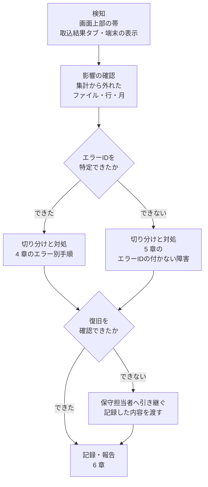

# 障害対応手順書

## 文書情報

| 項目 | 内容 |
|---|---|
| 文書名 | 障害対応手順書 |
| 文書ID | OP-INC-001 |
| システム名 | 売上分析ダッシュボード |
| 版 | 1.0 |
| 作成日 | 2026-11-16 |
| 状態 | 承認済 |

## 改版履歴

| 版 | 日付 | 変更内容 |
|---|---|---|
| 1.0 | 2026-11-16 | 新規作成 |

## 1. 目的と対象

### 1.1 目的

画面に誤りの表示が出たとき、集計の数字がおかしいときに、原因の切り分けから復旧の確認・記録までを同じ手順で行えるようにする。エラーID（詳細設計書 4 章の例外表）ごとに、確かめることと対処を示す。

### 1.2 使う人と使う場面

| 使う人 | 使う場面 |
|---|---|
| 利用者 | 画面上部に黄色の帯・赤の表示が出たとき。「取込結果」タブに読めなかったファイル・除外した行が出たとき |
| 運用担当者 | 利用者から相談を受けたとき。ファイルを直しても解消しないとき |
| 保守担当者 | 画面に一般的な失敗の表示だけが出るとき（ERR-201）。SQL・ライブラリを変えた後に動かなくなったとき |

### 1.3 対象と対象外

| 区分 | 範囲 |
|---|---|
| 対象 | 売上明細の読み込み・検証（FN-001・FN-002）、SQL への取込と集計（FN-003〜FN-007・FN-012）、Excel・印刷用ページの出力（FN-008・FN-009）、画面（FN-011） |
| 対象外 | 販売管理システム側の障害、利用者の PC・ブラウザ自体の故障、SQL Server 版（`sql/sqlserver/`。未実行のため手順を定めない） |

このシステムは利用者の PC の中だけで動き（127.0.0.1 で待ち受け）、読み込んだ明細はメモリ上のデータベースにだけ置く。元のファイルを書き換えることはなく、画面を閉じるとデータは消える。そのため、どの障害でも「元のファイルを直して読み込み直す」「画面を起動し直す」で元の状態に戻せる。

## 2. 障害時の基本の流れ



| 段階 | 行うこと |
|---|---|
| 検知 | 画面上部の帯（黄色＝除外した行・読めなかったファイルがある、赤＝集計できる明細がない）、「取込結果」タブ、起動した端末の表示を見る |
| 影響の確認 | 「取込結果」タブの件数（読み込んだファイル・集計対象の行・除外した行・空行）と、集計の対象から外れた月がないかを確かめる |
| 切り分け | 3 章の順に確かめ、エラーIDを特定する |
| 対処 | 4 章（エラーIDあり）または 5 章（エラーIDなし）の手順で行う |
| 復旧の確認 | 読み込み直して、黄色・赤の表示が消えること、または除外した行が想定どおりの件数になることを確かめる |
| 記録・報告 | 6 章の項目で記録し、運用担当者へ報告する |

## 3. 切り分けの順番

上から順に確かめる。どこで誤りが見つかったかで、エラーIDの範囲が決まる。

| 順 | 確かめる場所 | 見るもの | 該当するエラーID |
|---|---|---|---|
| 1 | 画面上部の帯 | 黄色の帯「読み込み N ファイル・M 行　／　集計対象 K 行　／　除外 X 行・読めなかったファイル Y 件（詳細は「取込結果」タブ）」、赤の表示「集計できる明細がありません。「取込結果」の理由を確認してください。」 | 下の 2・3 へ |
| 2 | 「取込結果」タブの「読めなかったファイル」 | 「ファイル名」「理由」の表 | ERR-001〜ERR-005 |
| 3 | 「取込結果」タブの「除外した行」 | 「ファイル名」「元の行番号」「理由」の表（「除外した行を CSV で保存」で保存できる） | ERR-101〜ERR-111 |
| 4 | 画面全体 | 英語の一般的な失敗の表示（「This app has encountered an error. The original error message is redacted to prevent data leaks.」で始まる文） | ERR-201、または 5 章 |
| 5 | 画面を起動した端末 | 例外の種類（`sqlite3.OperationalError` など）とトレースバック | ERR-201、または 5 章 |

「元の行番号」は見出し行を 1 行目として数えた番号で、表計算ソフトで開いたときの行番号と一致する。1 行に複数の誤りがあるときは、理由が「／」でつながって表示される。

理由の文言からエラーIDを引く表：

| 画面の理由（コードの文言） | エラーID |
|---|---|
| 対応していない形式です（.csv または .xlsx を選んでください） | ERR-001 |
| 文字コードを判定できません（UTF-8 または Shift_JIS で保存してください） | ERR-002 |
| Excel ファイルとして開けません | ERR-003 |
| 必須の列がありません：（列名） | ERR-004 |
| ファイルが空です／CSV として読めません（列の数がそろっていない行があります） | ERR-005 |
| 伝票番号・得意先コード・商品コード・得意先名・地域・担当者・商品名・商品カテゴリ のいずれか ＋「が空です」 | ERR-101 |
| 行番号が空です／行番号が1以上の整数ではありません | ERR-102 |
| 売上日が空です | ERR-103 |
| 売上日を日付として読めません | ERR-104 |
| 数量が空です | ERR-105 |
| 数量が整数ではありません | ERR-106 |
| 数量が0です | ERR-107 |
| 単価が空です／原価単価が空です | ERR-108 |
| 単価が数値ではありません／原価単価が数値ではありません | ERR-109 |
| 単価がマイナスです／原価単価がマイナスです | ERR-110 |
| 明細の重複（同じ伝票番号・行番号の明細を先に読み込み済み） | ERR-111 |

ファイルそのものを確かめるときは、次のコマンドが使える（Linux・WSL の場合）。

```bash
head -n 1 売上明細.csv                         # 1 行目の列名を見る
iconv -f UTF-8 -t UTF-8 売上明細.csv > /dev/null && echo UTF-8   # UTF-8 として読めるか
iconv -f CP932 -t UTF-8 売上明細.csv > /dev/null && echo CP932   # Shift_JIS（CP932）として読めるか
```

## 4. エラー別の対応手順

すべてのエラーで共通すること：

- 読み込みをやり直すと、メモリ上の明細はすべて入れ替わる（TC-046）。同じファイルを何度読み込み直しても、明細が二重に計上されることはない
- 画面には外部への送信機能がないため、再実行による二重送信は起こらない
- Excel・印刷用ページを出力し直すと、保存日時の入った新しいファイル名（`売上分析_YYYYMMDD_HHMM.xlsx` など）で保存される。誤った集計で出力したファイルは、利用者が手で削除・差し替えする

### 4.1 ERR-001 対応していない形式

| 項目 | 内容 |
|---|---|
| 事象 | 「読めなかったファイル」に「対応していない形式です（.csv または .xlsx を選んでください）」 |
| 影響 | そのファイルの明細はすべて集計から外れる。他のファイルは読み込まれる。データは壊れない |
| 想定原因 | 拡張子が `.csv`・`.xlsx` 以外（`.xls`・`.xlsm`・`.txt` など）。ファイル選択の画面は .csv・.xlsx に絞っているが、拡張子の判定は読み込み処理でも行う |
| 確認すること | 「ファイル名」列の拡張子 |
| 対処 | 販売管理システムから CSV で出力し直す、または表計算ソフトで `.xlsx`（Excel ブック）か `.csv` で保存し直してから読み込む |
| 復旧の確認 | 「読めなかったファイル」からそのファイルが消え、「読み込んだファイル」の件数が 1 増える |
| 再実行してよいか | よい。副作用なし |
| 関連 | FN-001、TC-005 |

### 4.2 ERR-002 文字コードを判定できない

| 項目 | 内容 |
|---|---|
| 事象 | 「読めなかったファイル」に「文字コードを判定できません（UTF-8 または Shift_JIS で保存してください）」 |
| 影響 | そのファイルの明細はすべて集計から外れる。データは壊れない |
| 想定原因 | CSV が UTF-8（BOM の有無は問わない）・Shift_JIS（CP932）以外の文字コード（UTF-16 など）で保存されている。または、途中で文字コードが混ざったファイル |
| 確認すること | 3 章の `iconv` のコマンドで、どちらの文字コードでも読めないことを確かめる |
| 対処 | 表計算ソフトで開き、「CSV UTF-8（コンマ区切り）」または Shift_JIS の CSV で保存し直す。販売管理システムに出力時の文字コードの設定があれば UTF-8 か Shift_JIS にする |
| 復旧の確認 | 「読めなかったファイル」からそのファイルが消え、明細が集計対象の行に加わる |
| 再実行してよいか | よい。副作用なし |
| 関連 | FN-001、TC-006 |

### 4.3 ERR-003 Excel ファイルとして開けない

| 項目 | 内容 |
|---|---|
| 事象 | 「読めなかったファイル」に「Excel ファイルとして開けません」 |
| 影響 | そのファイルの明細はすべて集計から外れる。データは壊れない |
| 想定原因 | 拡張子は `.xlsx` だが中身が Excel ブックではない（拡張子だけを書き換えた CSV、壊れたファイル、パスワードで保護されたブック） |
| 確認すること | 同じファイルを表計算ソフトで開けるか。開けるなら「名前を付けて保存」で `.xlsx` として保存し直したものを試す |
| 対処 | 表計算ソフトで `.xlsx` として保存し直す。CSV が拡張子だけ `.xlsx` になっている場合は拡張子を `.csv` に戻す。保護されたブックは保護を外した写しを作る |
| 復旧の確認 | 「読めなかったファイル」からそのファイルが消える |
| 再実行してよいか | よい。副作用なし |
| 関連 | FN-001、TC-005 |

### 4.4 ERR-004 必須の列がない

| 項目 | 内容 |
|---|---|
| 事象 | 「読めなかったファイル」に「必須の列がありません：（足りない列名を「、」でつないだもの）」 |
| 影響 | そのファイルの明細はすべて集計から外れる。データは壊れない |
| 想定原因 | 1 行目の列名が入力データ仕様（04_入力データ仕様.md）の 13 列と違う。販売管理システムの出力の形式が変わった、列名を手で変えた、Excel の 1 枚目のシートが明細のシートでない（Excel は先頭のシートだけを読む） |
| 確認すること | 3 章の `head -n 1` で 1 行目を見る。画面に出た列名と見比べる（前後の空白は無視されるが、全角・半角の違いや表記の揺れは別の列名として扱われる） |
| 対処 | 1 行目の列名を入力データ仕様のとおりに直す。Excel の場合は明細のシートを先頭に移す。列の順序と余分な列は問わない（TC-007） |
| 復旧の確認 | 「読めなかったファイル」からそのファイルが消える |
| 再実行してよいか | よい。副作用なし |
| 関連 | FN-001、TC-005 |

### 4.5 ERR-005 空のファイル・列の数がそろわない CSV

| 項目 | 内容 |
|---|---|
| 事象 | 「読めなかったファイル」に「ファイルが空です」または「CSV として読めません（列の数がそろっていない行があります）」 |
| 影響 | そのファイルの明細はすべて集計から外れる。データは壊れない |
| 想定原因 | 中身が 0 バイトの CSV。見出しより列の多い行がある CSV（名称の中のカンマを引用符で囲まずに出力した、など） |
| 確認すること | ファイルの大きさ（`ls -l`）。表計算ソフトで開き、見出しより右に値がはみ出している行がないか |
| 対処 | 空のファイルは出力し直す。列のはみ出しは、該当行の名称に含まれるカンマを直すか、引用符で囲む形式で出力し直す |
| 復旧の確認 | 「読めなかったファイル」からそのファイルが消える |
| 再実行してよいか | よい。副作用なし |
| 関連 | FN-001、TC-005 |

### 4.6 ERR-101 必須の文字列項目が空

| 項目 | 内容 |
|---|---|
| 事象 | 「除外した行」の理由に「（列名）が空です」（伝票番号・得意先コード・商品コード・得意先名・地域・担当者・商品名・商品カテゴリ） |
| 影響 | その行だけが集計から外れ、売上・粗利がその分少なく表示される。他の行は集計される。データは壊れない |
| 想定原因 | 販売管理システムで未入力のまま出力された明細。前後の空白だけの値も空として扱う |
| 確認すること | 「除外した行」の「ファイル名」「元の行番号」で元のファイルの該当行を開く |
| 対処 | 元のファイルの該当行に値を入れて保存し、読み込み直す。販売管理システム側で直せる場合はそちらを直して出力し直す |
| 復旧の確認 | 「除外した行」からその行が消え、「集計対象の行」が増える |
| 再実行してよいか | よい。副作用なし |
| 関連 | FN-002、TC-012、TC-014、TC-018 |

### 4.7 ERR-102 行番号が空または 1 以上の整数でない

| 項目 | 内容 |
|---|---|
| 事象 | 「除外した行」の理由に「行番号が空です」または「行番号が1以上の整数ではありません」 |
| 影響 | その行だけが集計から外れる。データは壊れない |
| 想定原因 | 行番号が未入力、0、マイナス、小数、文字 |
| 確認すること | 元のファイルの該当行の「行番号」 |
| 対処 | 1 以上の整数に直して読み込み直す。行番号は伝票番号と組で明細を見分ける鍵のため、同じ伝票の他の行と重ならない番号にする |
| 復旧の確認 | 「除外した行」からその行が消える。新たに ERR-111（重複）が出ないこと |
| 再実行してよいか | よい。副作用なし |
| 関連 | FN-002、TC-012 |

### 4.8 ERR-103 売上日が空

| 項目 | 内容 |
|---|---|
| 事象 | 「除外した行」の理由に「売上日が空です」 |
| 影響 | その行だけが集計から外れ、どの月の売上にも入らない。データは壊れない |
| 想定原因 | 売上日が未入力の明細 |
| 確認すること | 元のファイルの該当行の「売上日」 |
| 対処 | 売上日を入れて読み込み直す |
| 復旧の確認 | 「除外した行」からその行が消える |
| 再実行してよいか | よい。副作用なし |
| 関連 | FN-002、TC-012 |

### 4.9 ERR-104 売上日を日付として読めない

| 項目 | 内容 |
|---|---|
| 事象 | 「除外した行」の理由に「売上日を日付として読めません」 |
| 影響 | その行だけが集計から外れる。データは壊れない |
| 想定原因 | 受け付ける書式（`YYYY-MM-DD`・`YYYY/MM/DD`・`YYYYMMDD`・Excel の日付・5 桁で 30000〜99999 の日付シリアル値）以外。存在しない日付（2025-02-30 など）。和暦や「1月6日」のような表記 |
| 確認すること | 元のファイルの該当行の「売上日」。表計算ソフトで開いた場合は、表示ではなくセルの中身を見る |
| 対処 | 受け付ける書式に直して読み込み直す |
| 復旧の確認 | 「除外した行」からその行が消え、正しい月に集計される |
| 再実行してよいか | よい。副作用なし |
| 関連 | FN-002、TC-011、TC-012、TC-018 |

### 4.10 ERR-105 数量が空

| 項目 | 内容 |
|---|---|
| 事象 | 「除外した行」の理由に「数量が空です」 |
| 影響 | その行だけが集計から外れる。データは壊れない |
| 想定原因 | 数量が未入力の明細 |
| 確認すること | 元のファイルの該当行の「数量」 |
| 対処 | 数量を入れて読み込み直す |
| 復旧の確認 | 「除外した行」からその行が消える |
| 再実行してよいか | よい。副作用なし |
| 関連 | FN-002、TC-012、TC-014、TC-016 |

### 4.11 ERR-106 数量が整数でない

| 項目 | 内容 |
|---|---|
| 事象 | 「除外した行」の理由に「数量が整数ではありません」 |
| 影響 | その行だけが集計から外れる。データは壊れない |
| 想定原因 | 小数（1.5 など）、数値として読めない文字。全角数字・桁区切りのカンマは自動で整えるため原因にならない |
| 確認すること | 元のファイルの該当行の「数量」 |
| 対処 | 整数に直して読み込み直す。返品はマイナスの整数で入れる（受け付ける。TC-013） |
| 復旧の確認 | 「除外した行」からその行が消える |
| 再実行してよいか | よい。副作用なし |
| 関連 | FN-002、TC-012 |

### 4.12 ERR-107 数量が 0

| 項目 | 内容 |
|---|---|
| 事象 | 「除外した行」の理由に「数量が0です」 |
| 影響 | その行だけが集計から外れる。数量 0 の行は金額も 0 のため、売上・粗利の合計は変わらない。明細数だけが少なくなる |
| 想定原因 | 取り消した明細・値引きだけの明細などを数量 0 で出力している |
| 確認すること | 元のファイルの該当行。販売管理システムで数量 0 の明細をどう扱っているか |
| 対処 | 集計に不要な行であれば、そのまま除外してよい。必要な場合は販売管理システム側で正しい数量にする |
| 復旧の確認 | 除外の件数が想定どおりであること |
| 再実行してよいか | よい。副作用なし |
| 関連 | FN-002、TC-012、TC-018、TC-047 |

### 4.13 ERR-108 単価または原価単価が空

| 項目 | 内容 |
|---|---|
| 事象 | 「除外した行」の理由に「単価が空です」または「原価単価が空です」 |
| 影響 | その行だけが集計から外れる。データは壊れない |
| 想定原因 | 単価・原価単価が未入力の明細 |
| 確認すること | 元のファイルの該当行 |
| 対処 | 値を入れて読み込み直す |
| 復旧の確認 | 「除外した行」からその行が消える |
| 再実行してよいか | よい。副作用なし |
| 関連 | FN-002、TC-012 |

### 4.14 ERR-109 単価または原価単価が数値でない

| 項目 | 内容 |
|---|---|
| 事象 | 「除外した行」の理由に「単価が数値ではありません」または「原価単価が数値ではありません」 |
| 影響 | その行だけが集計から外れる。データは壊れない |
| 想定原因 | 「未定」「-」などの文字、数値として読めない記号。全角数字・桁区切りのカンマ・「円」・「¥」は自動で取り除くため原因にならない |
| 確認すること | 元のファイルの該当行 |
| 対処 | 数値に直して読み込み直す |
| 復旧の確認 | 「除外した行」からその行が消える |
| 再実行してよいか | よい。副作用なし |
| 関連 | FN-002、TC-010、TC-012、TC-014、TC-018 |

### 4.15 ERR-110 単価または原価単価がマイナス

| 項目 | 内容 |
|---|---|
| 事象 | 「除外した行」の理由に「単価がマイナスです」または「原価単価がマイナスです」 |
| 影響 | その行だけが集計から外れる。データは壊れない |
| 想定原因 | 返品・値引きを単価のマイナスで表している |
| 確認すること | 元のファイルの該当行 |
| 対処 | 返品は数量をマイナスにし、単価は 0 以上で入れる（数量のマイナスは受け付ける。TC-013） |
| 復旧の確認 | 「除外した行」からその行が消え、売上がマイナスとして集計される |
| 再実行してよいか | よい。副作用なし |
| 関連 | FN-002、TC-012、TC-018 |

### 4.16 ERR-111 明細の重複

| 項目 | 内容 |
|---|---|
| 事象 | 「除外した行」の理由に「明細の重複（同じ伝票番号・行番号の明細を先に読み込み済み）」 |
| 影響 | 2 件目以降の行が集計から外れる。同じ明細の二重計上を防ぐための動作で、データは壊れない。ただし、残るのは先に読んだ行（ファイル名の昇順で先のファイル、同じファイル内では上の行）のため、修正版のファイルと元のファイルを一緒に選ぶと、修正前の行が残る |
| 想定原因 | 同じ月のファイルを 2 回選んだ。期間の重なる 2 つのファイルを選んだ。修正版と元のファイルを一緒に選んだ。販売管理システムで伝票番号・行番号が重なっている |
| 確認すること | 「除外した行」の「ファイル名」と、先に読まれたファイル（名前の昇順で前のもの）。同じ伝票番号・行番号の行を両方のファイルで比べる |
| 対処 | 二重に選んだだけなら対処不要（除外のままでよい）。修正版を使う場合は、元のファイルを選ばずに読み込み直す。伝票番号・行番号が本当に重なっている場合は、販売管理システムの出力を確かめる |
| 復旧の確認 | 除外の件数が想定どおりで、残った行が意図したファイルのものであること（得意先別・商品別の金額で確かめる） |
| 再実行してよいか | よい。副作用なし |
| 関連 | FN-002、TC-015、TC-016、TC-018 |

### 4.17 ERR-201 SQL の実行に失敗

| 項目 | 内容 |
|---|---|
| 事象 | 画面に英語の一般的な失敗の表示（「This app has encountered an error. The original error message is redacted to prevent data leaks.」で始まる文）だけが出て、指標・グラフが表示されない。ファイルの場所などの詳細は画面に出さない設定（`.streamlit/config.toml` の `showErrorDetails = "none"`）のため、起動した端末に例外とトレースバックが出る |
| 影響 | 集計・出力ができない。SQL ファイルは 1 ファイルずつ 1 つのトランザクションで実行し、失敗したらそのファイルの変更を取り消す。失敗したデータベースは画面に保持されず、次の操作で作り直される。データベースはメモリ上だけにあり、元のファイルも書き換えないため、データは壊れない |
| 想定原因 | `sql/` に追加した番号付きの SQL ファイルの誤り（起動時の適用で失敗する。例：構文の誤りでは `sqlite3.OperationalError: near "…": syntax error`）。取込処理 `sql/procedures/load_sales.sql` の変更の誤り。ライブラリの版を変えたことによる動作の違い |
| 確認すること | 1. 起動した端末の例外の種類とメッセージ ／ 2. `git status`・`git log` で `sql/`・`requirements.txt` に変更がないか ／ 3. `python -m pytest` が全件合格するか（SQL の適用・取込・集計の結果を確かめるテストを含む） |
| 対処 | 変更を加えた直後なら、変更を取り消すか誤りを直す（適用済みの番号のファイルは書き換えず、新しい番号のファイルで直す。06_導入・運用手順.md 7 章）。変更がないのに起きた場合は、端末を Ctrl＋C で止めて起動し直す。それでも起きる場合は、端末の表示（明細の値は含めない）を添えて保守担当者へ連絡する |
| 復旧の確認 | 起動し直して指標・グラフが表示される。`python -m pytest` が全件合格する |
| 再実行してよいか | よい。起動し直すとデータベースは新しく作られる。副作用なし |
| 関連 | FN-012、TC-040、TC-045、TC-046（ERR-201 を起こす試験は未実施。05_テスト仕様書.md 4 章） |

## 5. エラーIDの付かない障害

| 障害 | 事象 | 確認すること | 対処 |
|---|---|---|---|
| 起動できない（ライブラリがない） | `streamlit` のコマンドが見つからない、または端末に `ModuleNotFoundError` | 仮想環境（`.venv`）を有効にしているか。`pip install -r requirements.txt` を実行したか | 06_導入・運用手順.md 2 章の手順で導入し直す |
| 画面を開けない | ブラウザで「接続できません」 | 起動した端末が開いたままか（閉じる・Ctrl＋C で画面は止まる）。端末に表示されたアドレス・ポート | 起動し直し、端末に表示されたアドレスを開く。読み込んだデータは消えているため、ファイルを選び直す |
| 他の PC から開けてしまう・開けない | 社内の他の PC から開ける、または開けないという相談 | `ss -ltn` で待ち受けが `127.0.0.1` だけか（TC-084） | 認証がないため、127.0.0.1 以外で待ち受けない設定に戻す（`.streamlit/config.toml` の `address` と起動コマンドの `--server.address 127.0.0.1`）。他の PC からは使わせない |
| ファイルを選べない（大きすぎる） | ファイル選択の欄に大きさの上限を超えた旨の表示 | ファイルの大きさ。Streamlit 1.67.0 の既定の上限は 1 ファイル 200 MB で、`.streamlit/config.toml` では変更していない | 月ごとなど、上限より小さいファイルに分けて出力する |
| 動作が遅い・止まる（メモリ不足） | 読み込みに時間がかかる、PC 全体が重くなる | 読み込んだ行数（10 万行で約 1.7 秒を開発用の PC で確認。事務用の PC 相当、10 万行を超える件数は未確認：05_テスト仕様書.md TC-070・TC-087）。Excel は CSV より読み込みが遅い（10 万行で 7.91 秒） | 期間を分けて読み込む。Excel より CSV を使う。他のアプリを閉じる |
| 販売管理システムの出力形式の変更 | 列名・日付の書式・文字コードが変わり、ERR-002・ERR-004・ERR-104 などが一斉に出る | 変更前のファイルと 1 行目・値の書式を比べる | 出力の設定を元に戻す。戻せない場合は入力データ仕様の変更として保守担当者へ相談する（検証の規則は `sales_dashboard/loader.py`） |
| ライブラリの版を変えた後の不具合 | 画面の崩れ、グラフ・Excel 出力の異常、想定外の例外 | `requirements.txt` の版（版を固定している）と、実際に入っている版（`pip freeze`） | `pip install -r requirements.txt` で固定した版に戻す。版を上げる場合は `python -m pytest` と画面の撮影（06_導入・運用手順.md 6 章）で確かめてから使う |
| 想定外の例外（SQL 以外） | ERR-201 と同じ一般的な失敗の表示 | 起動した端末の例外の種類。`sqlite3` 以外の例外ならこの行に当たる | 元のファイルの写しと端末の表示（明細の値は含めない）を保守担当者へ渡す。明細の値を渡す必要がある場合は、架空の値に置き換えた写しで再現できるかを先に確かめる |

## 6. 障害の記録と報告

### 6.1 記録する項目

| 項目 | 書く内容 |
|---|---|
| 発生日時 | 誤りに気付いた日時と、画面を起動・読み込みした日時 |
| 検知方法 | 画面上部の帯／「取込結果」タブ／一般的な失敗の表示／利用者からの相談 など |
| エラーID | 4 章のID。付かない場合は 5 章の障害名 |
| 影響範囲 | 集計から外れたファイル名・行数・月、誤った集計で出力・配布した資料の有無 |
| 原因 | 確定した原因。確定していなければ「調査中」と、分かっていること |
| 対処 | 行った操作（ファイルの修正・出力し直し・起動し直し など）と、復旧を確かめた方法 |
| 再発防止 | 販売管理システムの出力設定の見直し、手順書への追記 など。不要なら「なし」と理由 |

記録には明細の値（得意先名・金額など）を書き写さない。行を示すときは「ファイル名」と「元の行番号」で示す。

### 6.2 報告のひな形

```markdown
## 障害報告：売上分析ダッシュボード

- 発生日時：YYYY-MM-DD HH:MM
- 検知方法：
- エラーID：ERR-xxx（障害名）
- 影響範囲：
  - 集計から外れたファイル・行：（ファイル名・元の行番号・件数）
  - 誤った集計で出力・配布した資料：あり／なし
- 原因：
- 対処：
- 復旧の確認：（読み込み直した結果、除外した行の件数 など）
- 再発防止：
- 報告者（役割）：利用者／運用担当者／保守担当者
```

## 7. エラーID対応表

詳細設計書（03_詳細設計.md）4 章の例外表のすべてのエラーIDを載せる。

| エラーID | 意味 | 発生する機能 | 節 | 関連テスト |
|---|---|---|---|---|
| ERR-001 | 拡張子が .csv・.xlsx 以外 | FN-001 | [4.1](#41-err-001-対応していない形式) | TC-005 |
| ERR-002 | UTF-8・Shift_JIS のどちらでも読めない | FN-001 | [4.2](#42-err-002-文字コードを判定できない) | TC-006 |
| ERR-003 | Excel として開けない | FN-001 | [4.3](#43-err-003-excel-ファイルとして開けない) | TC-005 |
| ERR-004 | 必須の列がない | FN-001 | [4.4](#44-err-004-必須の列がない) | TC-005 |
| ERR-005 | 中身が空・列の数がそろわない CSV | FN-001 | [4.5](#45-err-005-空のファイル列の数がそろわない-csv) | TC-005 |
| ERR-101 | 必須の文字列項目が空 | FN-002 | [4.6](#46-err-101-必須の文字列項目が空) | TC-012、TC-014、TC-018 |
| ERR-102 | 行番号が空・1 以上の整数でない | FN-002 | [4.7](#47-err-102-行番号が空または-1-以上の整数でない) | TC-012 |
| ERR-103 | 売上日が空 | FN-002 | [4.8](#48-err-103-売上日が空) | TC-012 |
| ERR-104 | 売上日を解釈できない | FN-002 | [4.9](#49-err-104-売上日を日付として読めない) | TC-011、TC-012、TC-018 |
| ERR-105 | 数量が空 | FN-002 | [4.10](#410-err-105-数量が空) | TC-012、TC-014、TC-016 |
| ERR-106 | 数量が整数でない | FN-002 | [4.11](#411-err-106-数量が整数でない) | TC-012 |
| ERR-107 | 数量が 0 | FN-002 | [4.12](#412-err-107-数量が-0) | TC-012、TC-018、TC-047 |
| ERR-108 | 単価・原価単価が空 | FN-002 | [4.13](#413-err-108-単価または原価単価が空) | TC-012 |
| ERR-109 | 単価・原価単価が数値でない | FN-002 | [4.14](#414-err-109-単価または原価単価が数値でない) | TC-010、TC-012、TC-014、TC-018 |
| ERR-110 | 単価・原価単価がマイナス | FN-002 | [4.15](#415-err-110-単価または原価単価がマイナス) | TC-012、TC-018 |
| ERR-111 | 伝票番号と行番号の組の重複 | FN-002 | [4.16](#416-err-111-明細の重複) | TC-015、TC-016、TC-018 |
| ERR-201 | SQL の実行に失敗（想定外） | FN-012 | [4.17](#417-err-201-sql-の実行に失敗) | 未実施（TC-040・TC-045・TC-046 は正常系） |

この表と 4 章の見出しが詳細設計書の例外表と一致していることは、自動テスト `tests/test_docs_trace.py`（TC-100）で確かめる。
